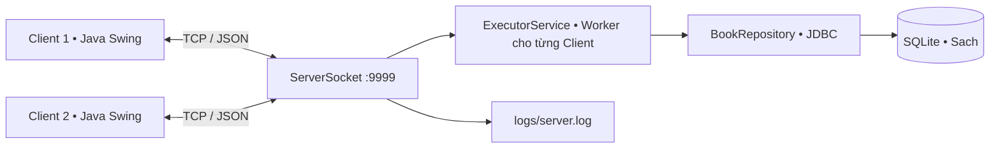

# Hệ thống quản lý thư viện qua mạng

Ứng dụng Java Swing theo mô hình Client–Server, giao tiếp bằng **Java Socket TCP**, lưu dữ liệu bằng **SQLite trên Server**. Hỗ trợ nhiều Client cùng kết nối, thêm / xem / tìm kiếm / sửa / xóa sách, thông báo lỗi kết nối và phát hiện xung đột cập nhật.

## Chạy nhanh trên Windows

Yêu cầu **JDK 17 trở lên**. Maven 3.8+ cần thiết khi biên dịch; lần đầu cần Internet để tải thư viện. Đã biên dịch với JDK 25, mã nguồn hướng tới Java 17.

1. Chạy `build.cmd` (hoặc `mvn clean verify`). Script cũng tìm Maven đi kèm NetBeans tại đường dẫn cài đặt trên máy hiện tại.
2. Chạy `run-server.cmd`, nhấn **Khởi động Server**. Cổng TCP mặc định là **9999**.
3. Chạy `run-client.cmd`, nhập **127.0.0.1**, cổng **9999**, tài khoản demo rồi nhấn **Đăng nhập**.
4. Mở thêm `run-client.cmd` để thử hai Client đồng thời, có thể dùng một tài khoản khác trên Client thứ hai.

Sau khi biên dịch, JAR đã chứa các thư viện, có thể sao chép sang máy khác có Java:

Khi biên dịch lại trên Windows, đóng các cửa sổ Server và Client đang chạy từ JAR này trước để giải phóng file JAR.

```powershell
java -jar target/library-management.jar
java -jar target/library-management.jar --server
java -jar target/library-management.jar --client --host 127.0.0.1 --port 9999
```

Không truyền tham số sẽ mở màn hình chọn chế độ. Mở nhiều Client từ đây hoặc chạy nhiều tiến trình Client.

### Chạy bằng NetBeans

**File → Open Project**, chọn thư mục chứa `pom.xml`, chọn JDK 17 hoặc mới hơn tại cấu hình Java Platform. **Clean and Build**, sau đó **Run Project**. Lớp chạy chính là `com.mycompany.library_management_system.Library_management_system`.

### Chỉnh giao diện bằng Swing Form / GUI Builder

Ba màn hình được xây dựng dưới dạng **NetBeans JFrame Form**, có cặp `.java` + `.form` cùng thư mục `src/main/java/com/mycompany/library_management_system/ui/`:

| Form | Nội dung |
|---|---|
| `LauncherFrame` | Chọn mở Server hoặc Client |
| `ServerFrame` | Cấu hình, khởi động/dừng Server, số Client và nhật ký |
| `ClientFrame` | Màn hình kết nối và màn hình quản lý sách |

Trong **Projects → Source Packages → com.mycompany.library_management_system.ui**, mở một trong ba file `.java`, chọn **Design**. Kéo thả thành phần từ **Palette**, chọn thành phần trong **Navigator**, chỉnh chữ/màu/font/kích thước ở **Properties**. Nhấn đúp nút để tới hàm xử lý sự kiện. **Shift+F6 / Run File** chạy trực tiếp từng Form.

`ClientFrame` chứa hai trang trong `root` dùng `CardLayout`: `connectionPage` (kết nối) và `managementPage` (quản lý). Trong Navigator, mở `[JFrame] → root` rồi chọn trang tương ứng để chỉnh; nhấn đúp trang hoặc **Design This Container** nếu cần xem riêng trang đó. Tham khảo thêm [hướng dẫn Swing Form](docs/SWING_FORM.md).

Giữ cả `.java` và `.form` khi sao chép/chia sẻ mã nguồn. Layout và widget được GUI Builder quản lý trong `initComponents()` và vùng khai báo biến có dấu `GEN-BEGIN` / `GEN-END`; chỉnh chúng qua tab Design. Mã xử lý Socket/CRUD, cấu hình JTable và Timer nằm ngoài vùng sinh tự động để NetBeans có thể tái tạo giao diện khi lưu Form.

### Hai máy trong mạng LAN

- Máy chủ chạy chế độ Server; giữ nguyên cổng 9999 hoặc chọn cổng khác.
- Máy Client nhập địa chỉ IPv4 LAN thực của máy chủ và đúng cổng. `127.0.0.1` chỉ trỏ tới chính máy đang chạy Client.
- Hai máy cần kết nối được với nhau; nếu tường lửa chặn thì cấu hình cho phép Java/TCP tại cổng đã chọn trong mạng thử nghiệm.
- File SQLite chỉ nằm trên máy Server. Client không cần cài SQLite hoặc chia sẻ thư mục database.

### Server không có giao diện

```powershell
java -jar target/library-management.jar --server --headless --port 9999 --db data/library.db
```

Dừng bằng `Ctrl+C`. Đường dẫn tương đối được tính từ thư mục chạy lệnh. Có thể dùng đường dẫn tuyệt đối cho `--db`.

## Sử dụng

- **Thêm:** chọn **+ Sách mới**, điền đủ 5 trường rồi nhấn **Thêm sách**.
- **Sửa:** chọn một dòng, thay đổi thông tin rồi nhấn **Lưu thay đổi**. Mã sách là khóa chính nên không sửa.
- **Xóa:** chọn sách, nhấn **Xóa sách đã chọn** và xác nhận.
- **Tìm:** nhập một phần mã/tên; hỗ trợ chữ hoa, chữ thường và tìm tiếng Việt không dấu. Từ khóa trống hiển thị tất cả.
- **Làm mới:** tải lại kết quả tìm kiếm hiện tại. Xóa từ khóa và tìm lại để hiện toàn bộ sách.
- Danh sách đồng bộ mỗi 8 giây; khi phát hiện mất kết nối ứng dụng quay về màn hình kết nối và thông báo.
- Các số thống kê tính theo danh sách hiện tại. **Sắp hết sách** là số đầu sách có số lượng ≤ 3.
- Phím tắt: `Ctrl+F` tìm, `Ctrl+N` sách mới, `Ctrl+R` tải lại.

Mã sách dài 1–10 ký tự; tên và tác giả 1–100 ký tự. Năm xuất bản là số nguyên từ 1 đến năm hiện tại + 1. Số lượng là số nguyên không âm. Kiểm tra được thực hiện ở cả giao diện và Server.

Khi Client khác đã sửa hoặc xóa sách đang được chỉnh sửa, Server từ chối ghi đè và báo xung đột. Bản nháp trên form được giữ lại; chọn lại dòng đã tải mới để lấy phiên bản hiện tại trước khi chỉnh sửa tiếp.

## Dữ liệu và kiến trúc

Server tự tạo `data/library.db` với 8 sách mẫu và hai tài khoản demo khi tạo bảng lần đầu. Dữ liệu được giữ qua các lần chạy; danh mục đã xóa hết sẽ không tự thêm lại dữ liệu mẫu. Có thể tạo database riêng bằng `src/main/resources/database.sql` và `src/main/resources/advanced.sql`.

| Tài khoản demo | Mật khẩu |
|---|---|
| `admin` | `admin123` |
| `bandoc` | `bandoc123` |

Mật khẩu được lưu dưới dạng hash PBKDF2-HMAC-SHA256 với salt ngẫu nhiên. `admin` có vai trò quản lý sách; `bandoc` chỉ được tìm kiếm, mượn/trả và xem phiếu mượn của chính mình. Server kiểm tra quyền trên mỗi lệnh TCP nên ẩn nút trên giao diện không phải là biện pháp phân quyền duy nhất. Nhật ký không ghi mật khẩu. Bản demo chưa có công cụ tạo hoặc quản trị tài khoản.

Chọn sách trong danh mục rồi bấm **Mượn sách** để mượn một bản. Nút **Phiếu mượn** mở lịch sử riêng của tài khoản và cho phép trả sách. Server cập nhật phiếu và số lượng trong cùng giao dịch, từ chối mượn khi hết sách, trả phiếu lặp hoặc xóa sách còn đang được mượn. Sau khi đăng nhập, Client cũng nhận thông báo UDP về sách được thêm, sửa, xóa, mượn hoặc trả; TCP vẫn là kênh dữ liệu chính.

Nhật ký Client, gồm tài khoản, thao tác và kết quả, được ghi ở `logs/client-activity.log`. Nhật ký Server ở `logs/server.log`.



| Thành phần | Vị trí |
|---|---|
| Điểm chạy chung | `src/main/java/com/mycompany/library_management_system/Library_management_system.java` |
| Kết nối Client | `…/client/LibraryClient.java` |
| Server TCP và nhật ký | `…/server/LibraryServer.java` |
| SQL, kiểm tra và xử lý xung đột | `…/server/BookRepository.java` |
| Giao thức / DTO | `…/protocol/`, `…/model/Book.java`, `…/model/Loan.java` |
| Giao diện Swing Form | `…/ui/ClientFrame.java` + `.form`, `…/ui/ServerFrame.java` + `.form`, `…/ui/LauncherFrame.java` + `.form` |
| Tạo bảng và sách mẫu | `src/main/resources/database.sql` |
| Schema tài khoản và phiếu mượn | `src/main/resources/advanced.sql` |
| Kiểm thử tích hợp TCP thực | `src/test/java/com/mycompany/library_management_system/LibraryServerIntegrationTest.java` |
| Báo cáo và ảnh minh chứng | `docs/BAO_CAO.md`, `docs/images/` |

Bảng `Sach` có đủ `MaSach VARCHAR(10) PRIMARY KEY`, `TenSach VARCHAR(100)`, `TacGia VARCHAR(100)`, `NamXB INT`, `SoLuong INT`. Thêm cột `Version INTEGER` để kiểm soát đồng thời. Database có bảng 5 trường từ trước được bổ sung cột Version, rồi áp dụng schema mở rộng có tính lặp lại an toàn.

**Database cũ:** Server tự bổ sung cột Role cho bảng tài khoản, giữ nguyên hash mật khẩu và gán READER cho tài khoản cũ. Để giữ lối quản trị, tài khoản `admin` hiện có được nâng lên ADMIN khi thêm cột Role. Nếu Role đã tồn tại, các vai trò hiện có được giữ nguyên.

Mỗi thao tác JDBC sử dụng kết nối riêng, câu lệnh có tham số, `busy_timeout` và chế độ WAL. UPDATE/DELETE dùng điều kiện `MaSach=? AND Version=?`; chỉ Client giữ phiên bản mới nhất được thay đổi. UPDATE tăng Version trong cùng transaction. SQLite khóa ghi và transaction bảo đảm hai Client không ghi đè âm thầm.

## Giao thức TCP

Mỗi thông điệp là **4 byte độ dài số nguyên big-endian**, sau đó đúng số byte **JSON UTF-8**. Giới hạn mỗi thông điệp 1 MiB. Giao thức không phụ thuộc ranh giới gói TCP; một kết nối xử lý tuần tự nhiều yêu cầu/phản hồi. `LOGIN` xác thực tài khoản; các thao tác với sách và phiếu mượn yêu cầu đăng nhập trên cùng kết nối.

```json
{"command":"ADD","book":{"code":"S009","title":"Lập trình mạng","author":"Tác giả mẫu","year":2025,"quantity":12,"version":0}}
```

```json
{"success":true,"message":"Thêm sách thành công.","books":[{"code":"S009","title":"Lập trình mạng","author":"Tác giả mẫu","year":2025,"quantity":12,"version":0}]}
```

| Lệnh | Dữ liệu | Kết quả thành công |
|---|---|---|
| `PING` | Không | `PONG` |
| `LIST` | Không | Danh sách sách |
| `SEARCH` | `query` | Sách có mã/tên phù hợp |
| `ADD` | `book` | Sách đã thêm, version 0 |
| `UPDATE` | `book`, gồm `version` đã tải | Sách đã cập nhật, version mới |
| `DELETE` | `code`, `version` đã tải | Danh sách rỗng |
| `LOGIN` | `username`, `password`, `udpPort`, `udpToken` | Phiên và vai trò đã xác thực |
| `BORROW` | `code` | Tạo phiếu mượn, giảm số lượng khả dụng |
| `RETURN` | `loanId` của chủ tài khoản | Đánh dấu trả, tăng số lượng khả dụng |
| `LOANS` | Không | Lịch sử phiếu mượn của tài khoản đăng nhập |
| `QUIT` | Không | Phản hồi rồi đóng kết nối |

Lỗi nghiệp vụ giữ kết nối để người dùng sửa và thử lại. Thông điệp hỏng đóng kết nối sau phản hồi `PROTOCOL`. `errorCode` được bỏ qua khi thành công và có giá trị khi thất bại. Mã lỗi gồm `VALIDATION`, `INVALID_CREDENTIALS`, `AUTH_REQUIRED`, `ALREADY_AUTHENTICATED`, `FORBIDDEN`, `DUPLICATE`, `NOT_FOUND`, `CONFLICT`, `OUT_OF_STOCK`, `ALREADY_RETURNED`, `ACTIVE_LOANS`, `UNKNOWN_COMMAND`, `PROTOCOL`, `DATABASE`. Lệnh `LOGIN` trả thêm `role`: `ADMIN` hoặc `READER`.

## Kiểm thử

```powershell
mvn verify
mvn clean verify
```

Bộ kiểm thử khởi động Server TCP thật trên cổng trống và SQLite tạm, mở nhiều Client đồng thời. Kiểm tra CRUD/Unicode, dữ liệu không hợp lệ, tài khoản sai/đúng, lệnh không đăng nhập, mượn/trả, bản sách cuối khi tranh chấp, lịch sử riêng từng tài khoản, xóa sách đang được mượn, thông báo UDP, nhật ký không chứa mật khẩu, tính bền vững sau khởi động lại và khung JSON/TCP sai.

Ảnh và kịch bản kiểm thử thủ công được ghi trong `docs/BAO_CAO.md`. Hai Client trên cùng máy kiểm chứng đồng thời qua TCP loopback; kiểm thử giữa hai máy cần thực hiện trên mạng LAN thực tế.

## Phạm vi

Đáp ứng 5 yêu cầu bắt buộc và bốn tính năng nâng cao: đăng nhập/xác thực theo vai trò, mượn/trả, thông báo UDP và nhật ký Client. Mọi truy cập cơ sở dữ liệu tiếp tục được xử lý bởi Server. Mật khẩu được hash khi lưu; kết nối TCP chưa mã hóa TLS nên đây là bản dùng cho bài thực hành trên mạng tin cậy, chưa phù hợp để đưa trực tiếp ra Internet.
